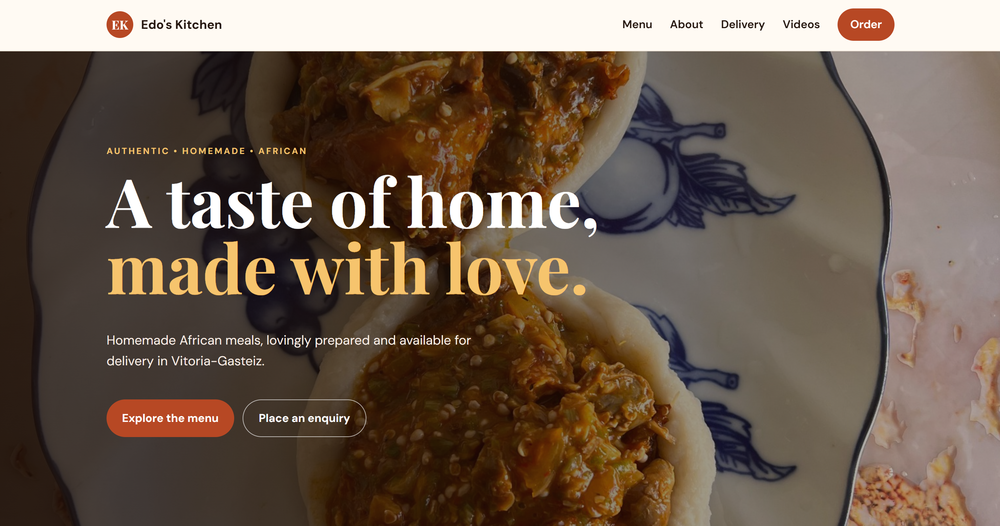

\# Hi there 👋 I'm Jude 👨‍💻\
\
\
\
&#x20; \<i>📍 Machine Learning Engineer | Artificial Intelligence | Web Development 🌎\</i>\
\
\
\
\
\
&#x20; 🌐 \*\*Connect with me:\*\*\
&#x20; \<a href="https\://www\.linkedin.com/in/jude-dontoh-42ab7011b">\
&#x20;   \\
&#x20; \</a>\
&#x20; \<a href="https\://www\.datascienceportfol.io/judedontoh">\
&#x20;   \\
&#x20; \</a>\
&#x20; \<a href="mailto:jude.dontoh@gmail.com">\
&#x20;   \\
&#x20; \</a>\
\
\
\
\---\
\
\## 🚀 Featured Projects\
\
\### 🤖 1. VisionTranslate – AI-Powered Camera Translation App\
\
An AI-powered camera application that recognises objects, extracts text from images and translates content into different languages.\
\
\*\*Project Preview:\*\*\
\
\
\
&#x20; \<a href="https\://judedontoh.github.io/visiontranslate2.0/">\
&#x20;   \\
&#x20; \</a>\
\
\
\
\- 🌐 \*\*Live Demo:\*\* [Try VisionTranslate]\(https\://judedontoh.github.io/VisionTranslate2.0/)\
\- 💻 \*\*Source Code:\*\* [View on GitHub]\(https\://github.com/judedontoh/visiontranslate2.0)\
\
\---\
\
\### 🌐 2. Edo's Kitchen – African Food Business Website\
\
A modern website created for a homemade African food business in Spain, showcasing food offerings and helping customers make enquiries.\
\
\*\*Project Preview:\*\*\
\
\
\
&#x20; \<a href="https\://edokitchen.netlify.app">\
&#x20;   \\
&#x20; \</a>\
\
\
\
\- 🌐 \*\*Live Website:\*\* [Visit Edo's Kitchen]\(https\://edokitchen.netlify.app)\
\- 🔒 \*\*Source Code:\*\* Maintained in a private GitHub repository.\
\
\---\
\
\## 💡 About Me\
\
I enjoy developing practical technology solutions, exploring artificial intelligence and machine learning, and building user-friendly web applications.\
\
I'm continuously learning, improving my technical skills and working on projects that solve real-world problems.\
\
\---\
\
\## 🛠️ Areas of Interest\
\
\- Machine Learning & Artificial Intelligence\
\- Computer Vision\
\- Web Development\
\- Data Science\
\- AI-powered Applications\
\
\---\
\
\
\
&#x20; \*\*Thanks for visiting my GitHub profile!\*\* ⭐\
\
\
let the energy wise project lead
