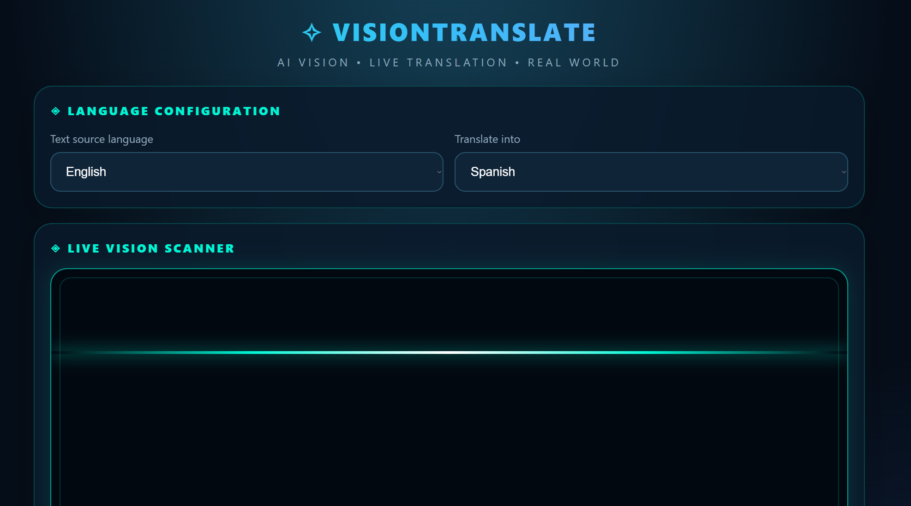

# Hi there 👋 I'm Jude 👨‍💻

\
   \<i>📍 Machine Learning Engineer | Artificial Intelligence | Web Development 🌎\</i> \

\
   🌐 \*\*Connect with me:\*\*     \<a href="[https://www.linkedin.com/in/jude-dontoh-42ab7011b](https://www.linkedin.com/in/jude-dontoh-42ab7011b)">     \   \</a>   \<a href="[https://www.datascienceportfol.io/judedontoh](https://www.datascienceportfol.io/judedontoh)">     \   \</a>   \<a href="mailto\:jude.dontoh\@gmail.com">     \   \</a> \

---

## 🚀 Featured Projects

### ⚡ 1. EnergyWise – Appliance Energy Consumption Forecasting & Analytics Dashboard

An end-to-end data science and machine learning project focused on analysing household appliance energy consumption and exploring short-term energy forecasting.

Built with Python, Pandas, Scikit-learn and Streamlit, EnergyWise transforms real-world energy consumption data into interactive visual insights and forecasting comparisons.

**Project Highlights:**

- 📊 Exploratory Data Analysis and data visualisation
- 🤖 Machine Learning with Random Forest Regression
- 📈 Time-series validation and model performance evaluation
- ⚡ Interactive energy analytics and forecasting dashboard
- 📥 Downloadable forecast reports

**Project Links:**

- 🌐 **Live Dashboard:** [Explore EnergyWise](https://energywise-jude.streamlit.app/)
- 💻 **Source Code:** [View on GitHub](https://github.com/judedontoh/EnergyWise)

---

### 🤖 2. VisionTranslate – AI-Powered Camera Translation App

An AI-powered camera application that recognises objects, extracts text from images and translates content into different languages.

**Project Preview:**

\
   \<a href="[https://judedontoh.github.io/visiontranslate2.0/](https://judedontoh.github.io/visiontranslate2.0/)">     \   \</a> \

- 🌐 **Live Demo:** [Try VisionTranslate](https://judedontoh.github.io/VisionTranslate2.0/)
- 💻 **Source Code:** [View on GitHub](https://github.com/judedontoh/visiontranslate2.0)

---

### 🌐 3. Edo's Kitchen – African Food Business Website

A modern website created for a homemade African food business in Spain, showcasing food offerings and helping customers make enquiries.

**Project Preview:**

\
   \<a href="[https://edokitchen.netlify.app](https://edokitchen.netlify.app)">     \   \</a> \

- 🌐 **Live Website:** [Visit Edo's Kitchen](https://edokitchen.netlify.app)
- 🔒 **Source Code:** Maintained in a private GitHub repository.

---

## 💡 About Me

I enjoy developing practical technology solutions, exploring artificial intelligence and machine learning, and building user-friendly web applications.

I'm continuously learning, improving my technical skills and working on projects that solve real-world problems.

---

## 🛠️ Areas of Interest

- Machine Learning & Artificial Intelligence
- Data Science & Predictive Analytics
- Computer Vision
- Web Development
- AI-powered Applications

---

\

&#x20; \*\*Thanks for visiting my GitHub profile!\*\* ⭐
\

